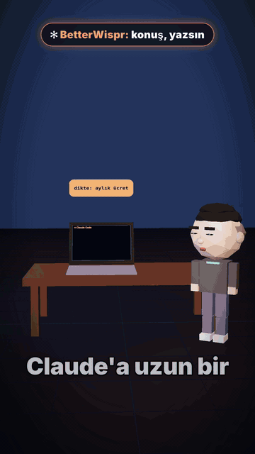
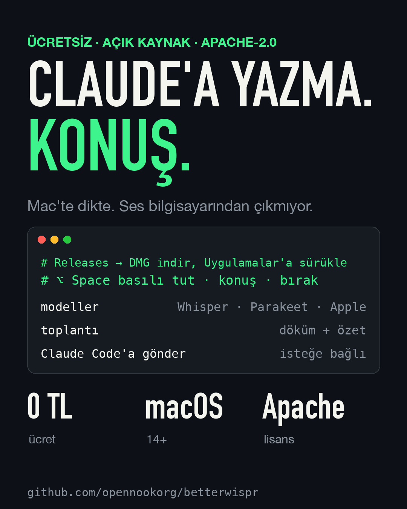

# Claude'a uzun istem yazmaktan parmaklarınız yorulduysa, artık konuşun. Ses Mac'inizden çıkmıyor.

Ücretsiz. Açık kaynak. Sesin Mac'inden çıkmıyor.

BetterWispr.

Claude'a uzun istem yazarken parmakların yoruluyor, dikte uygulamasının aylık ücreti de cabası. Bulut dikte araçları sesini başkasının sunucusuna gönderiyor.

Bu Mac uygulaması:
→ ⌥ Space basılı tut, konuş, bırak: yazı hangi uygulamadaysan oraya geliyor
→ Whisper, NVIDIA Parakeet ya da Apple'ın cihaz içi modeliyle yazıya çeviriyor
→ yanlış duyduğu kelimeyi bir kez düzeltince öğreniyor
→ sesli komutlar ("comma", "new line", "scratch that"; README'de İngilizce)
→ toplantıların canlı dökümü, cihazda özet ve yapılacaklar
→ isteğe bağlı: yazdıktan sonra Claude Code'a kendisi gönderiyor (varsayılan kapalı)

Kurulum: Releases sayfasından DMG'yi indir, Uygulamalar'a sürükle, modeli seç, mikrofon ve erişilebilirlik izni ver.

**📊 Rakamlarla:**
• 0 TL ücret
• macOS 14+
• Apache lisans

**⚙️ Nasıl başlarsın:**

**📌 Kısa notlar:**
• modeller: Whisper · Parakeet · Apple
• toplantı: döküm + özet
• Claude Code'a gönder: isteğe bağlı

**✨ Öne çıkanlar:**
• Whisper, Parakeet, Apple cihaz içi
• toplantı dökümü + özet
• yanlış kelimeyi bir kez düzelt, öğrensin

[▶ Tam kalite video: video.mp4](video.mp4)

## Videoda adım adım

1. Adı BetterWispr, Mac için ücretsiz ve açık kaynak bir sesle yazma uygulaması.
2. Option ve boşluk tuşunu basılı tutup konuşuyorsun, bıraktığında yazı hangi uygulamadaysan oraya geliyor.
3. Konuşmayı Whisper, Parakeet ya da Apple'ın cihaz içi modeliyle kendi Mac'inde yazıya çeviriyor.
4. Yanlış duyduğu bir kelimeyi bir kez düzeltince bir dahaki sefere doğru yazıyor.
5. Toplantıların canlı dökümünü ve özetini de cihazında çıkarıyor.
6. İstersen yazıyı Claude Code'a kendisi gönderiyor, ama bu seçenek kapalı geliyor.
7. macOS 14 ve üstü gerekiyor, kurulum için sürümler sayfasından uygulamayı indirip sürüklüyorsun.
8. Dikkat, bir API bağlantısı seçersen sesin o servise gidiyor ve ayar dosyaları şifrelenmiyor.

## Kaynak

- https://github.com/opennookorg/betterwispr

## Lisans

Bu depodaki video, kart ve metinler MIT lisanslıdır (LICENSE). Anlatılan aracın kendi lisansı kendi deposundadır.
